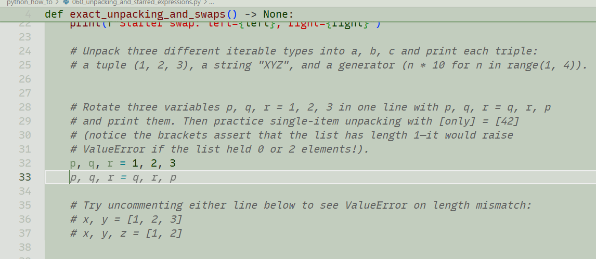

# Type and Complete

Learn to code by using an AI autocomplete of your choice, along with assisting plugins of your choice like AREPL in vscode for python among others. You can try using copilot autocomplete or use any other plugin for free without paying and just follow along with the free previews they offer.

| | |
| :---: | :---: |
|  |  |
 

It's based on the JAI coding language how_to style by Jonathan Blow. Currently there is a Odin and Python pack you can use with many others to come.

There is also a Tracy profiler how_to folder, it explores performance aware concepts.

Simply download the folder of your choice and get started coding.

## Contributing

Generally speaking most of the files are standalone outside of a few folders that show concepts like multifile compilation among others, you can contribute by adding more functions/lessons in each file or pointing out mistakes and errors. 

Or if you wish you can make your own repository that can be linked here where you can use the how_to_blueprint as a starting point for an AI agent to generate a new language how_to pack.

## License

Apache-2.0