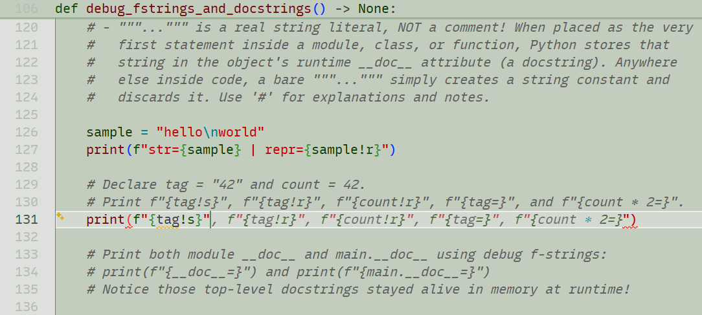

# Type and Complete

Learn to code using an AI autocomplete of your choice alongside helpful editor plugins (such as AREPL for Python in VS Code). You can use GitHub Copilot autocomplete or any other free plugin preview and follow along at your own pace.

<table>
  <thead>
    <tr>
      <th colspan="2">
<b>Examples</b>
</th>
    </tr>
  </thead>
  <tbody>
    <tr>
      <td width="50%" align="center"></td>
      <td width="50%" align="center"></td>
    </tr>
  </tbody>
</table>

Inspired by Jonathan Blow's Jai `how_to` style, this repository currently includes [`odin_how_to/`](odin_how_to/) and [`python_how_to/`](python_how_to/), with more languages to come. There is also a [`tracy_how_to/`](tracy_how_to/) workspace exploring performance-aware programming and profiling concepts.

Simply download or clone the folder of your choice and start coding.

## Contributing

Most files are standalone, aside from a few lab folders that cover multi-file compilation and larger concepts. You can contribute by:

- Adding more functions or drills to existing files
- Reporting mistakes, typos, or errors
- Creating your own repository using [`how_to_blueprint/`](how_to_blueprint/) as a starting point for an AI agent to generate a new language pack (which can be linked here)

## License

Apache-2.0
